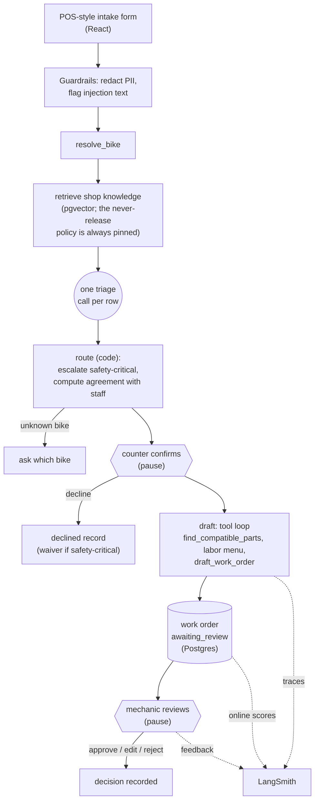

# CounterWrench

A front-of-house service intake tool for bike shops. Counter staff pick the customer's bike and log each complaint on a POS-style form. An agent triages each complaint, looks up the shop's own knowledge, checks parts compatibility with deterministic code, and drafts a work order that a mechanic must approve before anything is committed.

**Live demo: <https://counterwrench.shop>.** It sits behind a login. Ask the candidate (Justin), or Katy (who will be given one), for the password. The data is synthetic and the traces it produces are public.

**Contents:** [Try it](#try-it) · [How it works](#how-it-works) · [Evals](#evals) · [Before and after](#before-and-after) · [Failures and limits](#failures-and-limitations) · [Production evaluation](#production-evaluation) · [Public links](#public-links) · [AI usage](#ai-usage) · [Development](#development)

## Try it

You need Docker (Compose v2) and **one** model API key: Anthropic, OpenAI, Google or [OpenRouter](https://openrouter.ai), whichever you have. Nothing else (no Node, no Python). With several keys set, Anthropic is picked first, then OpenAI, Google, OpenRouter; the judge for the evals comes from a different model family than the agent when your keys allow it (the config says which models it chose, and warns when the judge shares the agent's family).

```sh
cp .env.example .env     # set one of ANTHROPIC_/OPENAI_/GOOGLE_/OPENROUTER_API_KEY; LANGSMITH_API_KEY is optional (tracing, evals)
make start               # builds the image, migrates, seeds, ingests, serves on http://localhost:8000
```

The numbers in this README come from one pinned configuration (Haiku 5.5 as agent, GPT-6.1 Sol as judge, both through OpenRouter with the serving backend fixed), so your scores on other models will differ; the LangSmith experiments are the reference. The model-selection rules are covered by tests (`tests/test_config.py`); the full app and the evals have been run end to end only on the OpenRouter configuration above, so if another provider's key misbehaves, `make doctor` (needs [uv](https://docs.astral.sh/uv/)) makes one real tool-calling and structured-output call per model and says what is wrong.

Things worth trying on the counter screen:

- A **normal job**: Hightower, "skipping", note "put a new chain on last month". The agent disagrees with the staff's "chain" pick (a worn cassette is the likelier cause) and says why.
- A **safety job**: "brake lever goes to the bar". The page goes red, the order is marked safety-critical, and it sorts first in the mechanic's queue.
- A **question**: "my brakes squeal". The agent asks one question, keeps your answer with its question, and stops asking after two rounds.
- The **mechanic's screens** (`/orders`): edit lines (validated against the catalog and the compatibility rules), approve, reject. Each order links to its public LangSmith traces.
- **Results** (`/evals`): every experiment, switchable by slice, with run-to-run spread, and a severity confusion matrix where you can click a cell to see its cases. **Judges** (`/evals/judges`): kappa and confusion matrices for each judge against the candidate's blind grades, with both graders' reasoning per item. **Explore** (`/explore`): the retrieval ranking for any query, and the compatibility engine's verdict for any bike and part. These pages read committed files, so they work with no LangSmith key; each order also shows its live scores when tracing is on.

## How it works



Design choices that shape the evals:

- **The LLM drafts, code computes.** Prices come from the catalog, estimates are summed in code, and parts compatibility is decided by a three-way rule engine (fits / doesn't fit / unknown), never by the model (D-012, D-019). So "does this part fit this bike" is a deterministic check, not a judgment.
- **Nothing is committed without a human.** The agent's only write is a draft in `awaiting_review`, and the database enforces it (D-024). The graph pauses on a Postgres checkpoint until a mechanic decides, even across a server restart.
- **Default to safety.** When braking, steering or wheel retention might be compromised and nobody knows yet, the order is safety-critical until a mechanic checks (D-041). Safety-critical orders sort first, and a customer who declines needs a signed waiver.
- **Staff's pick is a hypothesis.** The agent says whether it agrees with the staff's suspected area, and agreement is computed from the agent's own area pick rather than asserted (D-039).
- **Questions don't block the work order.** They ride along on the draft, capped at two rounds per row (D-037, D-051).

Stack: LangGraph, LangSmith, Postgres + pgvector, FastAPI (server-sent events), React + Tailwind. The catalog is 17 bikes, 84 parts, 37 labor items and 147 knowledge chunks from 17 authored shop docs. Every decision and why is in [docs/DECISIONS.md](docs/DECISIONS.md) (D-001 to D-054).

## Evals

The full explanation is in [docs/EVALS.md](docs/EVALS.md). In short:

- **Dataset.** 62 end-to-end cases in six slices (normal 18, edge 16, staff misattribution 8, note contradicts picklist 5, safety 8, adversarial 7), plus a 32-query retrieval set. The assistant drafted the intakes; **Justin labeled the expected severity, agreement and "should it ask" blind**, in a page that never showed the agent's answer. Only his labels are goldens (D-030, D-031).
- **24 evaluators on every end-to-end run.** 22 are deterministic or trajectory checks, each with a test showing it can fail (safety escalation, unsafe release, severity, agreement, clarification, labor, parts fit, prices, line coherence, PII, tool-call order and count). Two are LLM judges (diagnosis, explanation), pass/fail against versioned rubrics. The retrieval set is scored separately (recall@5 0.97, MRR 0.82 at baseline).
- **Judges were calibrated, not trusted.** Justin graded 40 judge outputs blind. After one rubric revision (tuned on dev items only), the diagnosis judge agreed with him on unseen items (held-out accuracy 0.88, kappa 0.60). The explanation judge did not (held-out kappa -0.20) and is documented as a coarse check, not a quality score. With only 7 fails in 40, those numbers rest on very few items (C-001).
- **One change per experiment**, on a clean git tree, 3 repetitions per case, models and OpenRouter backends pinned. Run-to-run spread is reported next to scores because it is as large as some of the gains.
- **Failures go to a review queue** and each was classified by root cause with Justin deciding (59 cases in the first run, [docs/FAILURES.md](docs/FAILURES.md)).

## Before and after

Seven experiments (E-001 to E-007), all **re-scored on today's labels** (the ones in force after the default-to-safety policy, D-041) so the columns compare. The same data is in the app's Evals pages, with every slice and a confusion matrix; [docs/EVAL_RESULTS.md](docs/EVAL_RESULTS.md) has each experiment's config, cost and notes, written at the labels of the day. Models: `claude-haiku-5.5` for agent and triage, `gpt-6.1-sol` as judge, via OpenRouter. Each full run is 62 cases x 3 repetitions, about 11 minutes and $2.20. Each score is the mean over all runs, with the spread (max minus min of the three repetition means) after the ±.

| Evaluator (all slices)                  | Baseline (E-001b) | After E-006 | After E-007 | What the log says                                                                                     |
| --------------------------------------- | ----------------- | ----------- | ----------- | ----------------------------------------------------------------------------------------------------- |
| safety_escalated                        | 0.72 ±0.05        | 0.89 ±0.00  | 0.91 ±0.05  | Beyond the spread. E-002 fixed `c03` and `n06`; `c02` (3/3) and `e10` (2/3 in E-007) are still missed |
| no_unsafe_release                       | 0.88 ±0.05        | 0.89 ±0.00  | 0.91 ±0.05  | Peaked at 1.00 after E-002, fell when E-003 let a draft proceed with an open question; same cases as above |
| no_over_escalation                      | 1.00 ±0.00        | 1.00 ±0.00  | 0.98 ±0.02  | Two runs of `n07` over-escalated in E-007. Before D-041 the braking cases counted as over-escalation (3 to 9 runs); the policy relabeled them |
| severity_correct                        | 0.84 ±0.05        | 0.92 ±0.03  | 0.90 ±0.05  | Gain to E-006 is larger than the spread; E-007's move is noise                                        |
| order_created_when_expected             | 0.88 ±0.02        | 0.98 ±0.00  | 0.98 ±0.00  | Beyond the spread (E-003: questions ride the draft)                                                   |
| line_coherence                          | 0.91 ±0.06        | 1.00 ±0.00  | 1.00 ±0.00  | Enforced in code (E-004)                                                                              |
| parts_categories_present                | 0.69 ±0.10        | 0.89 ±0.05  | 0.87 ±0.10  | Generic tube, and unverified parts drafted rather than dropped (E-006)                                |
| agreement_correct                       | 0.83 ±0.03        | 0.82 ±0.02  | 0.82 ±0.03  | No net change: fixed self-contradictions by construction, but too strict about adjacent areas (E-005) |
| clarification_correct                   | 0.91 ±0.01        | 0.89 ±0.05  | 0.82 ±0.02  | E-007 made the agent ask more, as the rule says; most of the drop is a cost of that change            |
| diagnosis_reasonable (judge, rubric v2) | 0.80 ±0.11        | 0.82 ±0.11  | 0.82 ±0.03  | Within noise; the judge was recalibrated later, so these aren't comparable with v3                    |
| explanation_quality (judge, rubric v2)  | 0.17 ±0.11        | 0.22 ±0.04  | 0.21 ±0.02  | Not meaningful: the judge failed calibration                                                          |

Rules used to read this table: a gap smaller than the spread of the three repetitions is noise; small slices (5 to 8 cases) have large spreads; and within-experiment spread understates between-experiment variation for the judge columns. **E-007** (a prompt line stating the default-to-safety policy) is logged as _inconclusive_: fewer missed runs and two over-escalated ones, with the headline moves inside the spread. It was kept because it states the policy, and the log says so. Baseline column: E-001b (E-001 re-scored on corrected labels, because the first report was built on corrupted scores, F-001). Run counts: 186 per experiment; E-006 has 183 scored (three runs lost to dropped connections, F-015).

## Failures and limitations

The full list is [docs/FAILURES.md](docs/FAILURES.md) (F-001 to F-016); the ones that matter most:

- **The first baseline report was wrong** (F-001): a LangSmith batch query duplicated and dropped feedback while its total looked right. Found because a case that escalated showed passing safety scores. Reports now fetch per run and refuse to report incomplete data.
- **Two safety cases are still missed:** `c02` (a squeak that could be a loose caliper) is held at needs-service in all three runs, and `e10` in two of three. The default-to-safety rule (D-041, E-007) helped but did not close them, and it brought two over-escalated runs on `n07`. Whether E-007's gain is real or noise was not separated; one re-run (about $2.40) would.
- **The explanation judge is uncalibrated** (held-out kappa -0.20). The deterministic checks (parts fit, prices, coherence, PII) and the diagnosis judge carry the weight; the explanation score should not be read as quality.
- **One labeler.** The goldens are one person's judgment. Where shops reasonably differ (extra labor), labels are ranges, but severity is a single label.
- **Compatibility is deliberately partial** (D-020): no rim internal width, no derailleur capacity vs cassette range, no valve-vs-drilling check, one wheel size per bike (D-017), and the catalog is the factory spec, so a modified bike relies on the intake note.
- **Small data**: 17 bikes, 62 cases, and one model family for the agent. Results are about the method, not about how accurate this agent would be in a real shop.
- **Planned but not done:** a run with a frontier model as the agent (so the cost-versus-quality gap, and which failures are model limits rather than data or design, is unmeasured); hybrid (keyword plus vector) search, which is only the vector baseline at retrieval recall@5 0.97; and a web-assisted guess for bikes that aren't in the catalog (they get labor-only orders for the mechanic to complete).
- **The live app's access control is a shared login.** Anyone with it can rate orders under any name.

## Production evaluation

The live app scores itself. After each triage and each drafted order, a background thread runs the _same evaluator code_ as the offline suite and posts the scores as feedback on that run's LangSmith trace: structure, safety consistency, parts, prices, coherence, tool-call trajectory, PII, and the two judges (on a configurable share of runs, `CW_JUDGE_SAMPLE`). Only checks that need no labeled answer run live (D-053). Mechanics' approve/edit/reject decisions land on the same trace.

- **Thumbs up/down** on any order (D-054). A thumbs-down needs a reason and puts the run in an annotation queue; a thumbs-up makes the order a _candidate_, never a golden. Candidates and rejected or edited orders become eval cases only when Justin labels them.
- `make prod-report` summarizes the live app (approved as drafted, edited, rejected, escalations, question-limit and unconfirmed-bike rates, thumbs, mean live scores, latency and cost, problem orders with safety first). `make prod-harvest` writes the orders worth labeling to a file. On the server, run them inside the app container: `docker compose -f docker-compose.yml -f docker-compose.prod.yml exec app python -m counterwrench.online.report`.
- **Alerting is described, not built.** Nothing here pages anyone. In a real shop a LangSmith alert on `safety_consistent` dropping, or on thumbs-down spiking, would notify Slack or email.
- Production traces go to their own project (`counterwrench-prod`) with a capped OpenRouter key and per-IP rate limiting.

## Public links

LangSmith (no login needed):

- A real order's **triage trace**: <https://smith.langchain.com/public/5a5c3a35-b063-4490-bf3e-acf2f465ef43/r>
- The same order's **drafting trace** (tool calls, compatibility check, draft), with the live scores attached to it: <https://smith.langchain.com/public/303599c0-07b4-47b4-b370-22fda1bb3a04/r>
- The **eval dataset and its experiments** (62 cases, E-001 to E-007): <https://smith.langchain.com/public/49648660-7f63-4526-9ab3-761a1e2982ee/d>

The annotation queues (`counterwrench-failures` from the offline analysis, `counterwrench-prod-failures` for thumbs-down) can't be shared publicly in LangSmith; [docs/FAILURES.md](docs/FAILURES.md) holds the reviewed findings.

## AI usage

This was built with an AI coding assistant working one approved step at a time: it proposed each step, the candidate approved the scope, and the assistant built it and reported results, including bad ones. The candidate labeled the goldens and judge-calibration set himself, blind to model output, decided every policy, and validated the bike-technical facts. [docs/AI_USAGE.md](docs/AI_USAGE.md) records, for every step, what the assistant did and what the candidate checked or decided.

## Development

```sh
make install          # create .venv and install dependencies (needs uv)
make doctor           # check keys, resolved models, and live tool-calling/structured-output calls
make up               # Postgres + pgvector only, for development
make seed             # migrate, load the catalog, embed the knowledge base
make api              # API on :8000;  make ui  # React dev server on :5173
make test             # pytest (600+ tests);  make ui-test  # vitest
make lint / format    # ruff
make upload-datasets  # sync the labeled datasets to LangSmith
make judge-smoke      # the judges on known good and bad outputs
make eval             # a full experiment (62 cases x 3, clean git tree)
make eval-report EXP=<experiment>      # scores with run-to-run spread
make eval-rescore EXP=<experiment>     # re-score recorded runs on current labels
make prod-report / prod-harvest        # the live app, see above
make db-ui            # pgAdmin on :5050, already connected
```
